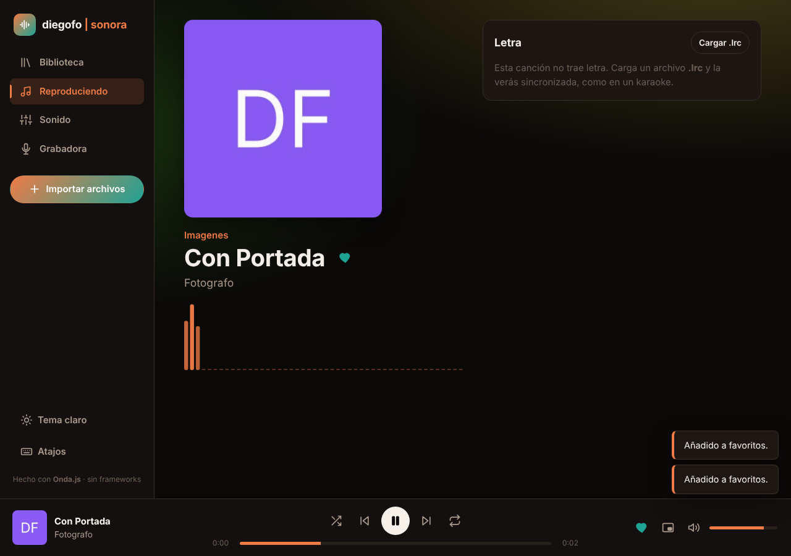
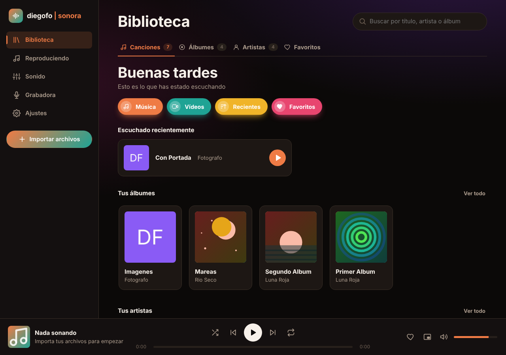
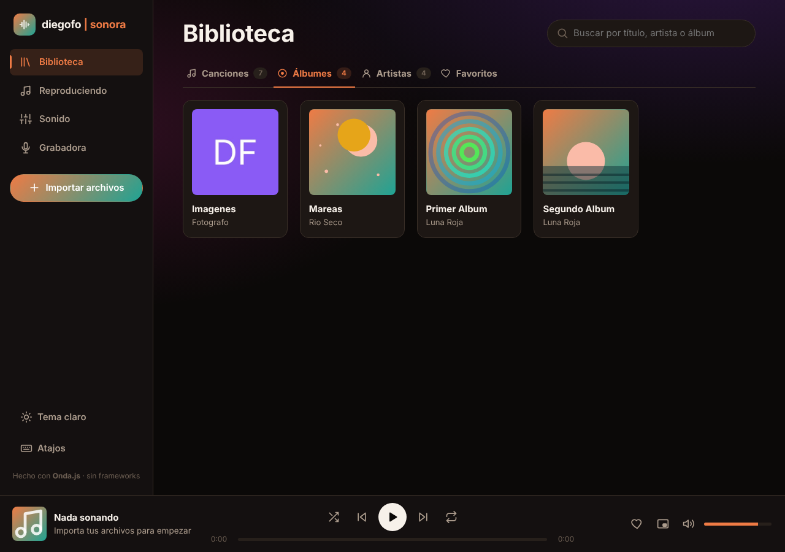
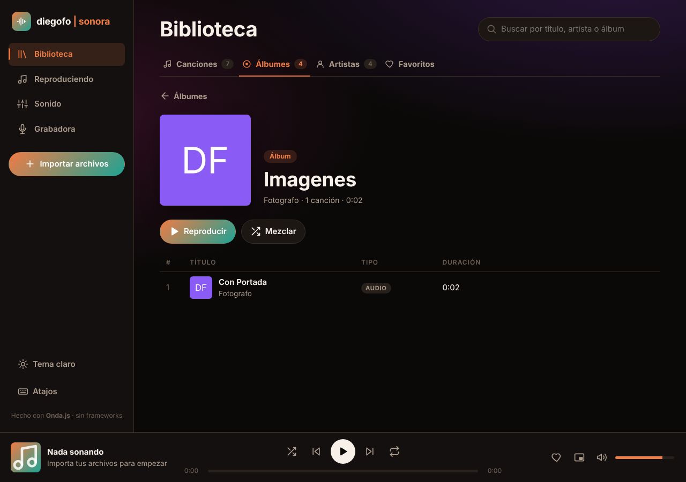
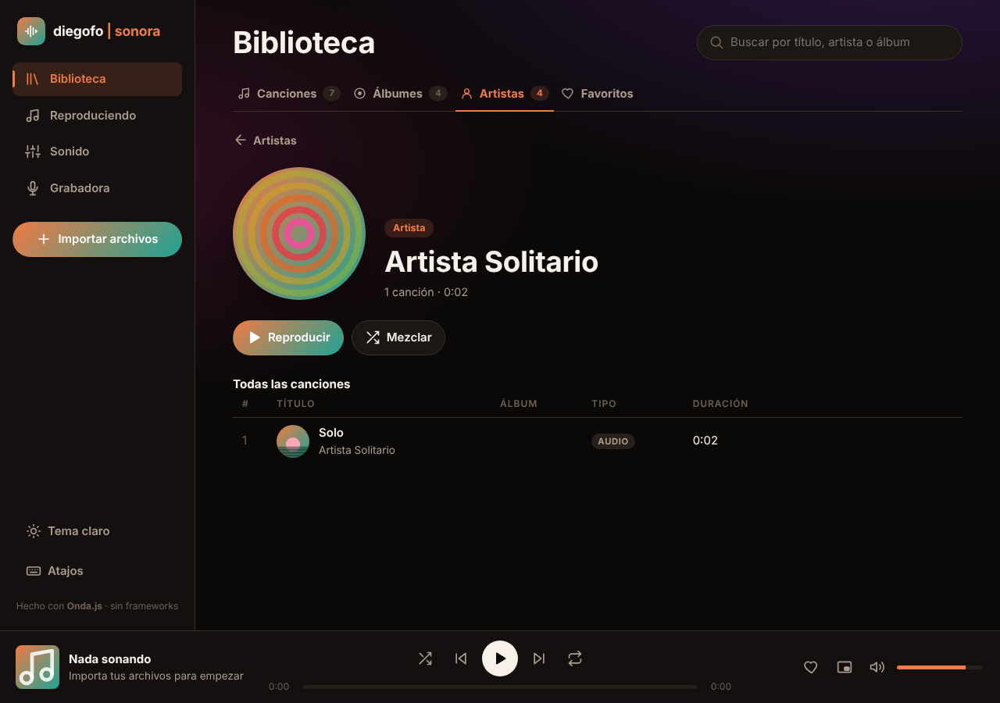
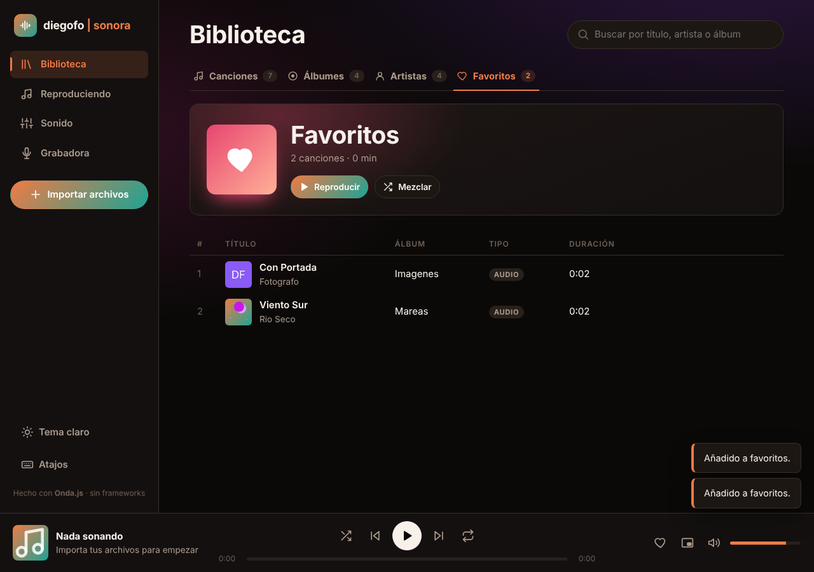
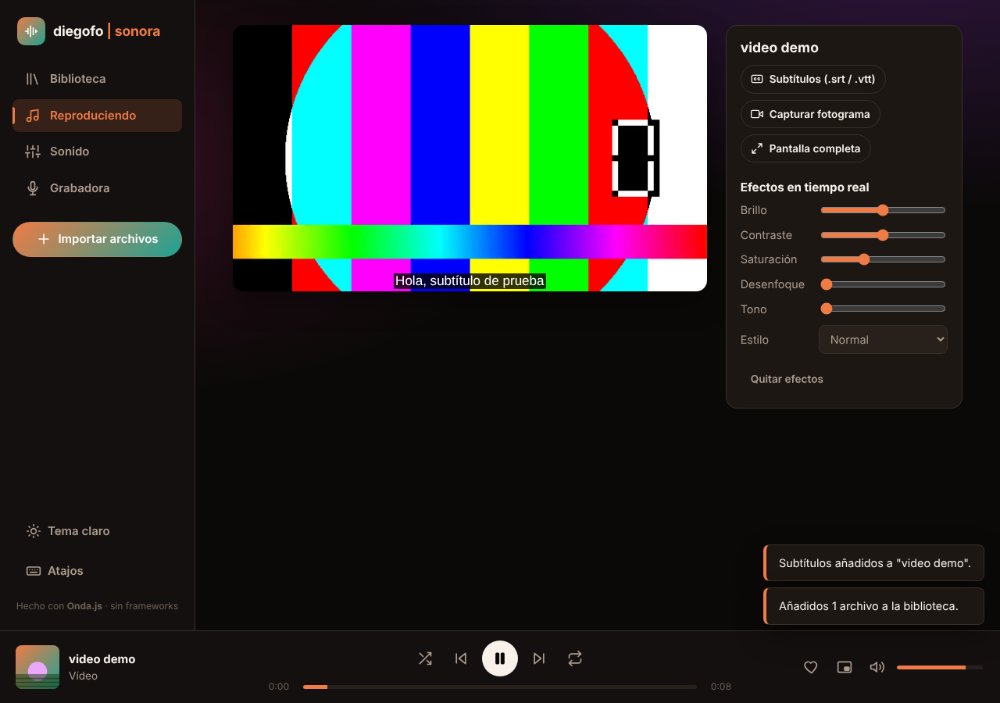
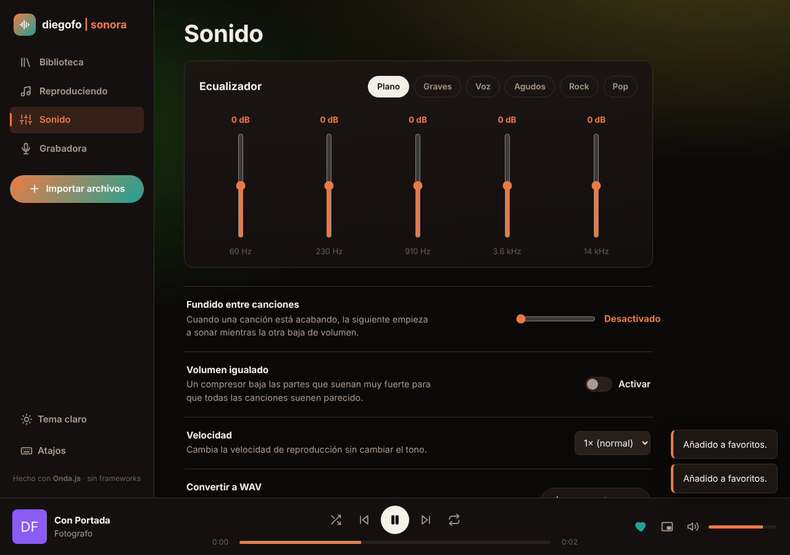
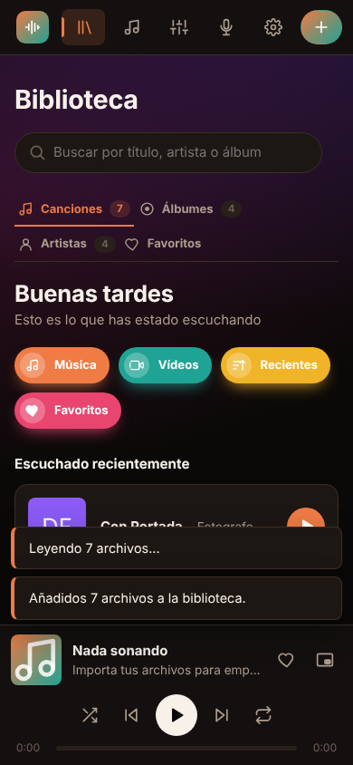
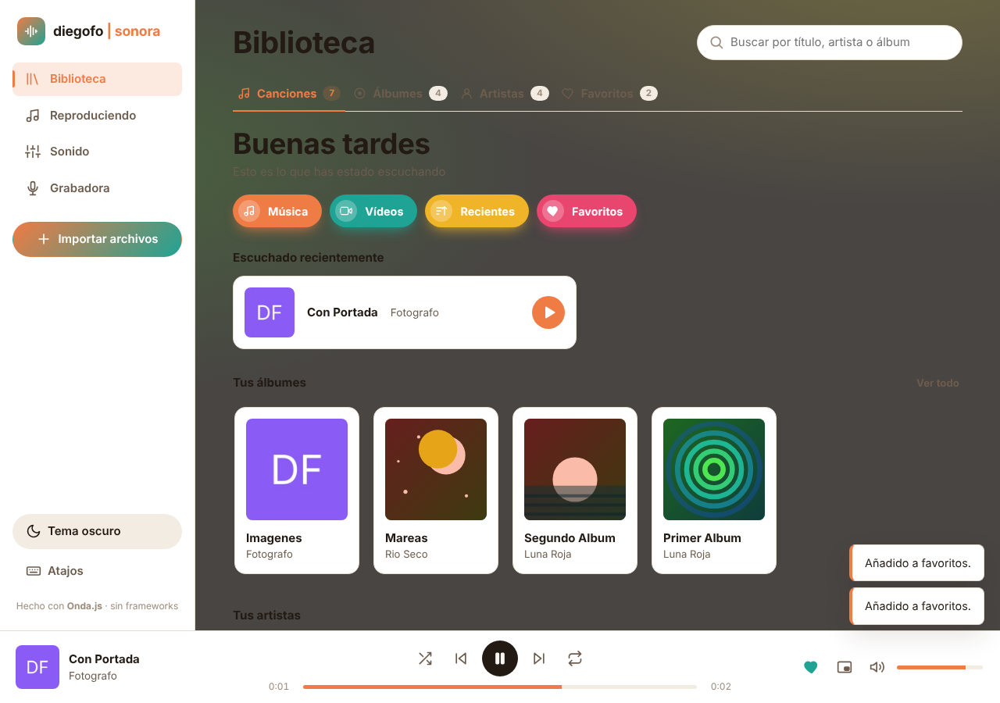

# 🎧 diegofo | sonora — Reproductor multimedia con librería propia

**Módulo:** Programación multimedia · **RA3**
**Alumno:** Diego Fernández Ortega · DAM, Segundo curso · Tame Formación
**Tecnologías:** HTML, CSS y JavaScript puro (sin frameworks ni librerías externas)



---

## 1. ¿Qué es este proyecto?

El reto era **crear nuestra propia librería o reproductor multimedia**. Yo he hecho las dos cosas:

| Parte | Qué es | Archivo |
|---|---|---|
| **Onda.js** | Mi librería multimedia. Es la parte "técnica": lee los archivos, procesa el sonido, graba y convierte. | `js/onda/onda.js` |
| **sonora** | El reproductor, al estilo de Spotify. Es la parte "visual": botones, listas y pantallas. Usa Onda.js por debajo. | `index.html`, `css/estilos.css`, `js/app.js` |

> 📖 **Librería:** un conjunto de funciones que se pueden reutilizar en otros programas. La idea es que Onda.js no sabe nada de botones ni de pantallas: solo hace el trabajo multimedia, y así se podría usar en otro proyecto distinto.

---

## 2. Cómo abrirlo

1. Descarga o clona la carpeta.
2. Abre `index.html` con **Chrome o Edge** (con doble clic funciona).
3. Pulsa **Importar archivos** o arrastra tus canciones y vídeos a la ventana.

En la carpeta `ejemplos/` hay una canción con su letra (`.lrc`) y un vídeo con sus subtítulos (`.srt`) para probarlo. Si los importas a la vez, la letra y los subtítulos se asocian solos porque tienen el mismo nombre.

> ⚠️ **Para la grabadora** es mejor abrirlo con la extensión **Live Server** de VS Code (clic derecho en `index.html` → *Open with Live Server*). Los navegadores solo dejan usar el micrófono y la cámara en páginas "seguras" (`https://` o `localhost`).

> ℹ️ La tipografía de los títulos (**Space Grotesk**) se carga desde Google Fonts, así que hace falta conexión a internet para verla; sin internet, la app sigue funcionando igual y usa la fuente del sistema.

---

## 3. Funcionalidades

### 🎵 Biblioteca
La biblioteca tiene **cuatro pestañas**, como en Spotify:

- **Canciones:** empieza con una **portada de inicio** (saludo según la hora, accesos rápidos a Música/Vídeos/Recientes/Favoritos, lo último escuchado y tiras de tus álbumes y artistas más recientes — ver 5.8), y debajo la lista completa con buscador, filtros (todo / música / vídeos) y un selector de **orden** (recientes, título, artista o duración). Por cada elemento: marcar como favorito, descargar el audio en **WAV** o quitarlo de la biblioteca.
- **Álbumes:** agrupa automáticamente las canciones que comparten álbum (usando la etiqueta `TALB` leída byte a byte). Cada álbum es una tarjeta con su carátula; al entrar se ve la lista de sus canciones, el año, la duración total y botones de **Reproducir** y **Mezclar**.
- **Artistas:** agrupa las canciones por artista (etiqueta `TPE1`). La ficha de un artista muestra sus álbumes y todas sus canciones juntas.
- **Favoritos:** las canciones y vídeos marcados con el corazón ♡. Los favoritos se guardan en el navegador (por artista + título), así que **siguen marcados aunque cierres la pestaña** y vuelvas a importar los mismos archivos.
- Importar música y vídeos con un botón o **arrastrando** a la ventana.
- Lee **el título, el artista, el álbum, el año y la carátula** de cada archivo, byte a byte (ver apartado 5.1). Si el archivo no tiene esos datos, el título y el artista se sacan del nombre: `Artista - Título.mp3`.
- Si el archivo **no trae carátula**, se dibuja una en el momento: un arte generativo (atardecer, luna, remolino, olas o anillos) distinto para cada canción/álbum/artista, en vez de dejar un cuadrado de color liso (ver 5.8).
- El buscador filtra a la vez canciones, álbumes, artistas y favoritos.



<p align="center">
  
  
</p>
<p align="center">
  
  
</p>

### ▶️ Reproducción
- Reproducir, pausa, anterior, siguiente, **aleatorio** y **repetir** (nada / toda la lista / una canción).
- Barra de progreso para saltar a cualquier punto y control de volumen.
- Botón "anterior" como en Spotify: si han pasado más de 3 segundos, vuelve al principio de la canción.
- **Visualizador** de barras que se mueve con la música.
- **Letras sincronizadas tipo karaoke** con archivos `.lrc`: la línea que se canta se ilumina y la lista se mueve sola. Al pulsar una línea, la canción salta a ese momento.
- Si el MP3 trae la letra dentro (etiqueta `USLT`), también se muestra.
- **Cola de reproducción "inteligente":** "siguiente" y "anterior" se quedan dentro de lo que estabas escuchando. Si le das a reproducir dentro de un álbum, suena ese álbum entero; si reproduces desde Favoritos, solo pasa por tus favoritos; si buscas algo y reproduces un resultado, sigue por esa búsqueda.
- **Favorito (♡)** también desde la propia pantalla de reproducción y desde la barra inferior, con la tecla **L** como atajo.

### 🎬 Vídeo
- Subtítulos en `.srt` o `.vtt` (los `.srt` se convierten a `.vtt` automáticamente).
- **Efectos en tiempo real**: brillo, contraste, saturación, desenfoque, tono, blanco y negro, sepia y negativo.
- **Capturar fotograma**: guarda la imagen actual del vídeo como PNG (con los efectos aplicados).
- Pantalla completa (botón, doble clic o tecla F).



### 🎚️ Sonido
- **Ecualizador de 5 bandas** (60 Hz, 230 Hz, 910 Hz, 3,6 kHz y 14 kHz) con ajustes preparados: Plano, Graves, Voz, Agudos, Rock y Pop.
- **Fundido entre canciones** (de 0 a 12 segundos).
- **Volumen igualado** para que todas las canciones suenen parecido.
- **Velocidad** de reproducción (de 0,5× a 2×) sin que la voz suene aguda.
- **Convertir a WAV** lo que está sonando, incluido el audio de un vídeo.



### 🎙️ Grabadora
- Graba el **micrófono**, la **cámara** o la **pantalla**.
- Vista previa en directo y cronómetro.
- Las grabaciones se pueden escuchar, descargar o **añadir a la biblioteca**.

### 🪟 Otros
- **Mini reproductor flotante** que se queda encima del resto de ventanas.
- **Tema claro y oscuro**.
- **Atajos de teclado** (botón "Atajos" en el menú).
- Funciona con las **teclas multimedia** del teclado y aparece en los controles del sistema.
- Recuerda tus ajustes (tema, volumen, ecualizador...) al cerrar.
- Se adapta al **móvil**.

<p align="center"> &nbsp; </p>

---

## 4. Estructura de carpetas

```
RA3-Multimedia/
├── index.html          → la página: estructura de todas las pantallas
├── css/
│   └── estilos.css     → colores, tamaños y diseño (tema claro/oscuro, móvil)
├── js/
│   ├── onda/
│   │   └── onda.js     → MI LIBRERÍA multimedia
│   ├── iconos.js       → iconos dibujados en SVG
│   └── app.js          → la aplicación: une la interfaz con la librería
├── ejemplos/           → archivos para probar
└── capturas/           → imágenes de este README
```

El orden de carga en `index.html` es importante: primero `onda.js` (la librería) y después `app.js` (que la usa).

---

## 5. Cómo funciona Onda.js por dentro

### 5.1. Leer los archivos byte a byte

> 📖 **Byte:** la unidad más pequeña de información de un archivo. Un número del 0 al 255.
> 📖 **ID3:** un bloque de datos que va al principio de los MP3 y guarda el título, el artista, la carátula, etc.

En vez de usar una librería, leo el archivo a mano:

1. Leo **solo los 10 primeros bytes**. Si los tres primeros son las letras `I`, `D`, `3`, el archivo tiene etiquetas.
2. En esos 10 bytes viene la **versión** y el **tamaño** del bloque. El tamaño está guardado en un formato raro llamado *syncsafe*: de cada byte solo valen 7 bits.
3. Leo **solo ese bloque** (no el archivo entero, que puede pesar muchos megas).
4. El bloque está dividido en **frames** (trozos). Cada uno empieza con un código de 4 letras:

| Código | Contiene |
|---|---|
| `TIT2` | Título |
| `TPE1` | Artista |
| `TALB` | Álbum |
| `TYER` / `TDRC` | Año |
| `APIC` | Carátula (una imagen JPG o PNG metida dentro del MP3) |
| `USLT` | Letra |

5. El primer byte de cada texto dice en qué **codificación** está (latín, UTF-16 o UTF-8), para que las tildes y la ñ salgan bien.
6. La carátula se convierte en una imagen que el navegador puede mostrar con `URL.createObjectURL`.

Funciona con las versiones **ID3 v2.2, v2.3 y v2.4**, y también con la antigua **ID3v1** (128 bytes al final del archivo).

```js
// Ejemplo de uso de la librería
const datos = await Onda.leerEtiquetas(archivo);
console.log(datos.titulo, datos.artista, datos.caratula);
```

### 5.2. El sonido: Web Audio API

> 📖 **Web Audio API:** herramienta del navegador para procesar sonido. Funciona como los pedales de una guitarra: el sonido entra, pasa por varios "nodos" (pedales) y sale por los altavoces.

La cadena de Onda.js es esta:

```
<audio>/<video> → volumen del canal → 5 filtros (ecualizador) → compresor* → analizador → volumen general → 🔊
                                                                 (*solo si "volumen igualado" está activado)
```

- **Filtros (BiquadFilter):** cada uno sube o baja una zona de frecuencias. El primero es de tipo *lowshelf* (todo lo grave), el último *highshelf* (todo lo agudo) y los del medio *peaking* (una "campana" alrededor de su frecuencia).
- **Compresor (DynamicsCompressor):** cuando el sonido pasa de cierto volumen, lo baja. Así las canciones muy fuertes y las flojas se quedan parecidas.
- **Analizador (AnalyserNode):** no cambia el sonido; me da 128 números con la fuerza de cada frecuencia, y con ellos dibujo las barras del visualizador en un `<canvas>`.
- **Fundido:** uso **dos** elementos `<audio>`. Cuando una canción está acabando, la siguiente empieza en el otro, y con `linearRampToValueAtTime` uno sube de 0 a 1 mientras el otro baja de 1 a 0.

### 5.3. Grabar

- `getUserMedia` pide permiso para el micrófono o la cámara.
- `getDisplayMedia` pide permiso para compartir la pantalla.
- `MediaRecorder` va guardando lo que llega en trozos cada 250 ms, y al parar los junta en un archivo (`Blob`).

> 📖 **Blob:** un "trozo de datos" en memoria que se comporta como un archivo.

### 5.4. Convertir a WAV byte a byte

Un WAV es el formato de audio más sencillo: una **cabecera de 44 bytes** y después todas las muestras de sonido seguidas. Onda.js:

1. Decodifica el archivo original con `decodeAudioData` (sirve para MP3, OGG, el audio de un MP4...).
2. Escribe la cabecera a mano con un `DataView` (`RIFF`, `WAVE`, `fmt `, `data`, número de canales, frecuencia...).
3. Convierte cada muestra (un número decimal entre -1 y 1) en un entero de 16 bits.

### 5.5. Letras y subtítulos

- **`.lrc`:** cada línea es `[minutos:segundos.centésimas]texto`. Con una expresión regular saco el tiempo y el texto, y mientras suena la canción busco qué línea toca.
- **`.srt` → `.vtt`:** el navegador solo entiende WebVTT. Un SRT es casi igual: basta con añadir la cabecera `WEBVTT` y cambiar la coma de los milisegundos por un punto (`00:00:01,500` → `00:00:01.500`).

### 5.6. Álbumes, artistas y favoritos

Esto ya es cosa de `app.js` (la aplicación), no de la librería, pero son las partes nuevas más importantes:

- **Agrupar por álbum o por artista:** recorro todas las canciones y las voy metiendo en un `Map` (una especie de diccionario) cuya clave es el nombre del álbum (o del artista) en minúsculas. Así, dos canciones con `TALB = "Luces"` acaban en el mismo grupo aunque el texto tenga mayúsculas distintas. Cada grupo se queda con la primera carátula que encuentra y con el año más antiguo que tenga alguna de sus canciones.
- **Favoritos que no se olvidan:** como los archivos en sí no se pueden guardar entre sesiones (el navegador no deja), en vez de guardar la canción guardo su "huella": `artista + "|" + título`, en minúsculas, en el almacenamiento del navegador (`localStorage`). Si vuelves a importar esa misma canción otro día, `sonora` calcula su huella, la compara con la lista guardada y la marca como favorita automáticamente.
- **La cola de reproducción:** cada vez que pulsas reproducir desde una lista (la tabla de canciones, un álbum, un artista o favoritos), esa lista se guarda como la "cola" actual (`estado.cola`, un simple array de identificadores). Los botones de siguiente y anterior, y el fundido entre canciones, recorren esa cola en vez de recorrer siempre toda la biblioteca.

### 5.7. Arte generativo y portada de inicio

Esta parte nació de comparar `sonora` con otro reproductor hecho por una compañera de clase (Serenia): el suyo se veía mucho más vivo porque no dejaba ningún hueco con un color plano. Para acercar `sonora` a eso añadí un módulo nuevo, `js/arte.js`, y una portada de inicio en la pestaña Canciones:

- **Arte generativo (`js/arte.js`):** cuando una canción, álbum o artista no trae una carátula real, en vez de pintar un cuadrado con un color liso y una inicial, se dibuja un pequeño SVG: un atardecer, una luna con estrellas, un remolino de círculos, unas olas o unos anillos. El dibujo y su color salen de una función **hash** (`huella`) que convierte el texto (título + artista, o el nombre del álbum/artista) en un número; ese número elige el tono de color (0-360°) y el patrón. Al ser siempre la misma cuenta para el mismo texto, **la misma canción tiene siempre la misma "carátula" inventada**, aunque recargues la página o la vuelvas a importar otro día.
- **Fondo ambiental:** la pantalla cambia muy sutilmente de color según lo que está sonando — un "mood lighting" que coge el mismo tono (`tono`) que ha salido para esa canción en `arteGenerativo()` y lo aplica a un degradado de fondo mediante la variable CSS `--amb-hue`, con una transición suave de un segundo para que no sea un cambio brusco.
- **Portada de inicio (`#hogar`):** al entrar en Canciones (si hay música importada y no hay una búsqueda activa) se ve primero un saludo, cuatro botones de acceso rápido (Música, Vídeos, Recientes, Favoritos), una tarjeta grande con lo último escuchado y dos tiras horizontales con tus álbumes y artistas más recientes — igual que la pantalla de inicio de Serenia o de Spotify, pero con sus propios colores y con las "carátulas" generativas cuando no hay una real. El saludo (`actualizarHogar()`, en `#saludoTexto`) es un simple "Hola, Diego": al principio era un saludo según la hora ("Buenas tardes"...), pero era literalmente el mismo texto que usa el reproductor de mi compañera (Serenia), así que lo cambié por algo propio.

Después de esto hice una segunda pasada de diseño más seria, porque la primera versión se quedó corta: era el típico "panel con tarjetas grises" que podría ser de cualquier aplicación. Cambié:

- **Los colores:** fuera el morado-rosa genérico; ahora todo gira en torno a un **ámbar-coral cálido** (como un atardecer, a juego con el propio arte generativo) sobre un fondo casi negro con un punto de marrón, con un **teal** frío como contraste para vídeo. Los mismos tonos valen para el tema oscuro y el claro.
- **La tipografía:** los títulos grandes (el logo, "Biblioteca", el nombre de la canción al reproducir, los álbumes...) usan ahora **Space Grotesk**, una tipografía con más carácter que la fuente del sistema, reservada solo para esos momentos importantes.
- **Sonido:** las cuatro tarjetas iguales de ajustes (fundido, volumen igualado, velocidad, convertir a WAV) eran soso y repetitivo. Ahora son una lista de ajustes agrupados con una línea fina entre cada uno -como los ajustes de un móvil-, debajo de un ecualizador con las bandas en vertical, como una mesa de mezclas real.
- **Favoritos:** antes era solo una tabla con dos botones encima. Ahora tiene una cabecera grande tipo "lista de reproducción" (como "Me gusta" en Spotify), con el número de canciones y la duración total.
- Se quitaron las "etiquetas" en mayúsculas que había encima de varios títulos (p.ej. "WEB AUDIO API" encima de "Sonido"): no aportaban nada y hacían que todo pareciese una plantilla genérica.
- Se quitó la firma "Hecho con Onda.js · sin frameworks" que había al pie del menú lateral, y se añadió una pestaña **Ajustes** nueva en el menú (antes el tema y los atajos de teclado estaban escondidos al pie del menú, sin ningún botón visible que llevara a ellos). Ahí viven juntos el cambio de tema, los atajos de teclado y el botón para vaciar la biblioteca guardada.

### 5.8. Que la biblioteca no se pierda al pulsar F5

Hasta ahora, los ajustes y los favoritos sí se guardaban (en `localStorage`), pero los archivos importados en sí solo vivían en la memoria de la pestaña: al refrescar la página con **F5** la biblioteca se quedaba vacía y había que volver a arrastrar todo. Para que eso no pase, cada canción o vídeo se guarda ahora entero -el archivo real, su carátula, su letra y sus subtítulos si los tiene- en una base de datos del propio navegador, con la API **IndexedDB** (a diferencia de `localStorage`, que solo guarda texto corto, IndexedDB puede guardar archivos enteros).

- Al importar un archivo, además de añadirlo a `estado.pistas` se llama a `guardarPistaBD(pista)`, que mete en la base de datos el archivo (`pista.archivo`, que ya es un `File`, se puede guardar tal cual) y descarga el contenido real de la carátula y de los subtítulos (que antes solo existían como una URL temporal) para guardarlos también.
- Al abrir la página, `iniciar()` llama a `cargarPistasBD()`, que lee todo lo guardado y reconstruye cada pista con URLs nuevas (`URL.createObjectURL`), exactamente como si acabaras de importar los archivos.
- Al quitar una canción de la biblioteca, también se borra de la base de datos (`quitarPistaBD`), y al añadir una letra o unos subtítulos más tarde, se actualiza el registro guardado.
- Como las URLs de las canciones ya no "mueren" al cerrar la pestaña, **el fundido, el aleatorio, la cola de reproducción y los favoritos siguen funcionando igual** después de recargar.

### 5.9. Resumen de la API de Onda.js

| Función / clase | Para qué sirve |
|---|---|
| `Onda.leerEtiquetas(archivo)` | Lee título, artista, álbum, año, carátula y letra |
| `Onda.leerDuracion(url, tipo)` | Duración de un archivo sin reproducirlo |
| `Onda.tipoDeArchivo(archivo)` | Dice si es `'audio'`, `'video'` o no soportado |
| `new Onda.MotorAudio()` | Ecualizador, compresor, volumen y fundidos |
| `new Onda.Visualizador(canvas, motor)` | Dibuja las barras de frecuencia |
| `new Onda.Grabadora()` | Graba micrófono, cámara o pantalla |
| `Onda.convertirAWav(archivo)` | Devuelve el audio en formato WAV |
| `Onda.capturarFotograma(video)` | Devuelve una imagen PNG del vídeo |
| `Onda.leerLRC(texto)` / `Onda.lineaActual(...)` | Letras sincronizadas |
| `Onda.srtAVtt(texto)` | Convierte subtítulos SRT a WebVTT |
| `Onda.formatearTiempo(seg)` | `125` → `"2:05"` |

---

## 6. Pruebas realizadas

| Prueba | Resultado |
|---|---|
| Leer etiquetas de MP3 con ID3 v2.3 y v2.4 (con tildes, ñ y €) | ✅ Correcto |
| Leer etiquetas ID3v1 y, si no hay, sacarlas del nombre del archivo | ✅ Correcto |
| Carátula incrustada en el MP3 | ✅ Se muestra |
| Importar MP3 + `.lrc` a la vez y que se asocien | ✅ Correcto |
| Letra sincronizada: se ilumina la línea correcta | ✅ Correcto |
| Vídeo MP4 con subtítulos `.srt` | ✅ Se ven los subtítulos |
| Ecualizador y ajustes preparados | ✅ Correcto |
| Convertir a WAV y descargarlo | ✅ Archivo válido |
| Siguiente / anterior / aleatorio / repetir | ✅ Correcto |
| Agrupar canciones por álbum y por artista | ✅ Correcto |
| Marcar/quitar favoritos y que se mantengan al recargar la página | ✅ Correcto |
| La cola de "siguiente/anterior" se queda dentro del álbum/artista/favoritos que estés viendo | ✅ Correcto |
| El buscador filtra a la vez canciones, álbumes y artistas | ✅ Correcto |
| Tema claro y versión móvil | ✅ Correcto |
| Arte generativo: cada canción/álbum/artista sin carátula saca un dibujo distinto y siempre el mismo para el mismo texto | ✅ Correcto |
| Carátula real e inventada conviviendo en la misma lista | ✅ Correcto |
| Portada de inicio: saludo, accesos rápidos, "escuchado recientemente" y tiras de álbumes/artistas | ✅ Correcto |
| El fondo ambiental cambia de tono al pasar de una canción a otra | ✅ Correcto |
| La portada de inicio se oculta al buscar algo | ✅ Correcto |
| La biblioteca sigue ahí después de pulsar F5 (archivo, carátula, letra y subtítulos incluidos) | ✅ Correcto |
| Los favoritos y la cola de reproducción siguen funcionando con la biblioteca recuperada tras F5 | ✅ Correcto |
| Consola del navegador sin errores | ✅ Sin errores |

### Problemas encontrados y cómo los resolví

1. **El sonido no salía al principio.** Los navegadores no dejan crear el audio hasta que el usuario hace clic. Solución: el motor de audio se crea en el primer clic de "reproducir" y uso `contexto.resume()`.
2. **Un elemento `<audio>` solo se puede conectar una vez a la Web Audio API.** Si lo conectas dos veces da error. Solución: el motor guarda en un `Map` los elementos ya conectados.
3. **Las grabaciones WebM decían que duraban "infinito".** Es un fallo conocido de los navegadores: el archivo no guarda su duración. Solución: saltar a un tiempo enorme (`currentTime = 1e101`); el navegador recorre el archivo y descubre la duración real.
4. **El tamaño del bloque ID3 salía mal.** Lo leía como un número normal, pero en ID3 es *syncsafe* (7 bits por byte). Solución: la función `leerSyncsafe`.
5. **Seguridad:** el título de una canción podría contener código HTML. Por eso los textos de los archivos se ponen siempre con `textContent` y nunca con `innerHTML`.
6. **Dos álbumes con el mismo nombre de artistas distintos se mezclaban.** Al agrupar solo por el nombre del álbum, "Singles" de un artista y "Singles" de otro aparecían como el mismo álbum. Solución: la clave del grupo es `álbum + artista`, no solo el álbum.
7. **Al pulsar "siguiente" dentro de un álbum, sonaba una canción de otro álbum.** Antes "siguiente" recorría siempre toda la biblioteca. Solución: guardar qué lista se está reproduciendo (`estado.cola`) cada vez que se pulsa play desde un sitio distinto.
8. **La biblioteca se veía muy plana comparada con otros reproductores.** Las carátulas que faltaban eran siempre el mismo cuadrado de color con una inicial, y el fondo era un único color fijo. Solución: el módulo `arte.js` genera un dibujo distinto por canción/álbum/artista (siempre el mismo para el mismo texto, gracias a una función hash), y ese mismo color "tiñe" levemente el fondo de la pantalla mientras suena esa canción.
9. **Al pulsar F5 se perdía toda la biblioteca importada.** Los archivos solo vivían en la memoria de la pestaña (`estado.pistas`), y las URLs de los `<audio>`/`<video>` (`blob:...`) dejan de existir al recargar. Solución: guardar cada pista entera (el archivo, no solo su nombre) en **IndexedDB** al importarla, y reconstruirla con URLs nuevas al arrancar la página (ver 5.8).
10. **El diseño se veía genérico, como una plantilla cualquiera.** Un morado-rosa muy visto, cuatro tarjetas idénticas en Ajustes y Favoritos reducido a una tabla sin personalidad. Solución: una paleta propia (ámbar-coral + teal), una tipografía de títulos con más carácter (Space Grotesk), unos ajustes reorganizados como una lista agrupada en vez de tarjetas repetidas, y una cabecera grande tipo "lista de reproducción" para Favoritos.
11. **El saludo de la portada de inicio era igual que el de la compañera.** "Buenas tardes" según la hora era justo el mismo texto que el reproductor de Serenia. Solución: un saludo propio y fijo, "Hola, Diego".

---

## 7. Compatibilidad

| Función | Chrome / Edge | Firefox |
|---|---|---|
| Reproductor, ecualizador, letras, vídeo | ✅ | ✅ |
| Grabadora | ✅ | ✅ |
| Mini reproductor de **vídeo** | ✅ | ⚠️ Solo con el botón que pone Firefox encima del vídeo |
| Mini reproductor de **música** | ✅ (versión 116+) | ❌ |

Los formatos que se pueden reproducir dependen del navegador (por ejemplo, `.mkv` no funciona en todos).

---

## 8. Mejoras futuras

- Leer también las etiquetas de **M4A** y **FLAC**, que usan formatos distintos a ID3.
- Listas de reproducción propias, además de los álbumes automáticos.
- Capítulos en los vídeos.

---

**Autor:** Diego Fernández Ortega · [GitHub](https://github.com/DiegoFdzOrtega) · [LinkedIn](https://linkedin.com/in/diegofdzortega)
